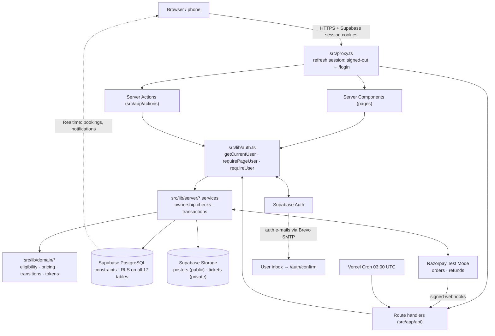
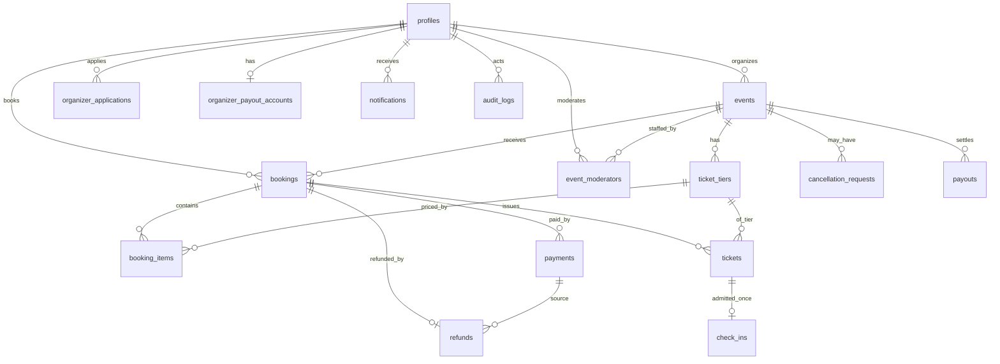
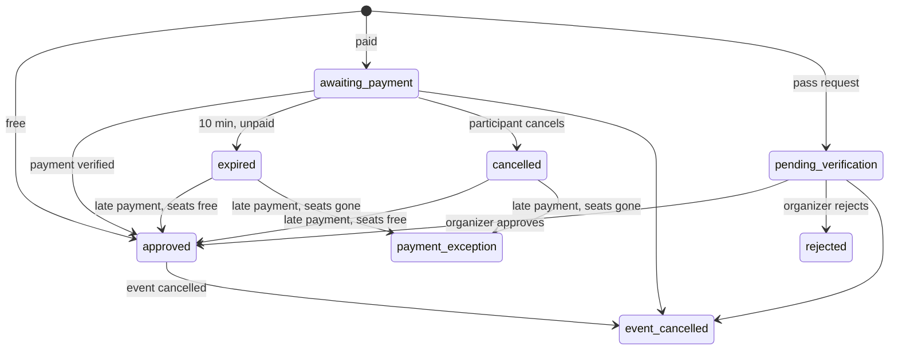
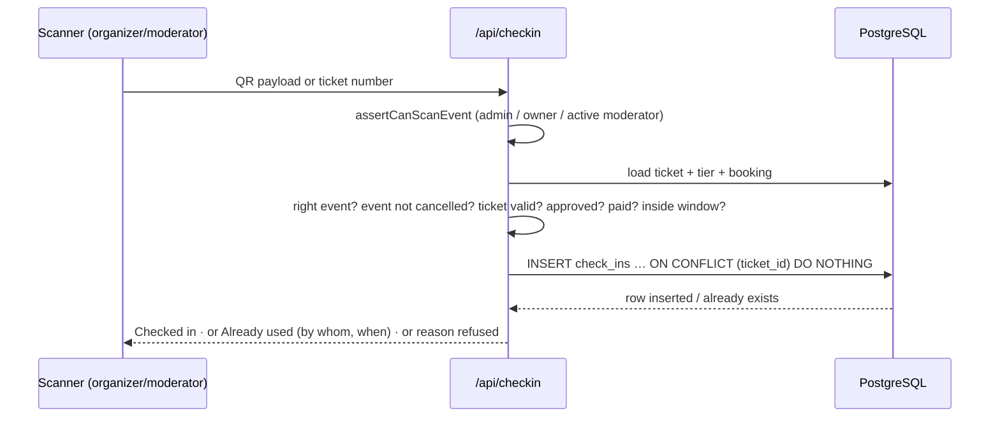

# EventDeck — Project Maintenance Manual

The single document to read when you return to EventDeck after months away. Every statement is based on the repository (commit `00bb5bf` plus the working-tree changes of 23 Oct 2026) or on checks run on 23 Oct 2026; anything that is a recommendation, not a fact, is labelled **Recommendation**.

Related documents: [README](../README.md) · [Architecture](architecture/PROJECT_ARCHITECTURE.md) · [Environment variables](ENVIRONMENT_VARIABLES.md) · [Development setup](development/DEVELOPMENT_SETUP.md) · [Windows manual](WINDOWS_SETUP_AND_RUN.md) · [Deployment](deployment/DEPLOYMENT_GUIDE.md) · [Testing](testing/TESTING.md) · [Troubleshooting](troubleshooting/TROUBLESHOOTING.md) · [Cleanup report](REPOSITORY_CLEANUP_REPORT.md)

---

## 1. Project overview

**What it is.** EventDeck is a web application for running events at a multi-campus university (built around SRM Institute of Science and Technology). It covers the whole life of an event: publication, discovery, booking, payment, ticket issue, door check-in, cancellation with refunds, organizer payouts, notifications, audit and reports.

**Problem it addresses.** Campus events are usually run with posters, generic forms, payment screenshots and printed lists, which cannot enforce seat limits, eligibility, payment verification or single admission. EventDeck enforces those rules on the server and in the database.

**Users.**

| User | What they do |
| --- | --- |
| Participant | Signs up (SRM campus, other college or guest), browses events, books free/paid tickets or requests a complimentary pass, pays, downloads QR tickets/PDF |
| Organizer | Everything a participant can do, plus creates/publishes events with tiers, windows and audience rules, reviews pass requests, appoints moderators, scans, views attendance, requests cancellation and payouts |
| Event moderator | An ordinary account assigned to one event; can only scan tickets for that event |
| Administrator | Approves organizers, cancellations and payouts, processes refunds, resolves payment exceptions, reads the audit log, exports reports |

**Implemented features** (verified in code): four-step sign-up with institution profiles; organizer applications; events with tiers, capacities, registration/check-in windows, posters and audience rules (campus-only, inter-campus, approved colleges, open); a platform limit of 4 tickets per person per event; transactional seat reservation with 10-minute payment holds; Razorpay Test Mode payments plus a local simulator; QR tickets and PDF passes; event-scoped moderators; QR/manual check-in admitting each ticket once; cancellation → refunds; payouts (recorded, not transferred); in-app realtime notifications; audit log; CSV reports.

**Not implemented / out of scope:** waiting lists, invite-only allow-lists, numbered seat maps, native mobile apps, live (real-money) payments, automated bank payouts, app-level rate limiting.

**Status on 23 Oct 2026:** lint/type check/unit tests pass; **`npm run build` fails** because Next.js 16.4.0 refuses to build with a known critical advisory (see §18); production runs on Vercel at `https://eventdeck.online` (last verified 15 Oct 2026).

---

## 2. Technology stack

Versions are those installed from `package-lock.json`.

| Technology | Version | Why it is used | Where | Config |
| --- | --- | --- | --- | --- |
| Next.js (App Router, Turbopack) | 16.4.0 | Server-rendered pages, Server Actions, route handlers, edge proxy | `src/app`, `src/proxy.ts` | `next.config.ts` |
| React | 19.3.0 | UI | `src/components`, `src/app` | — |
| TypeScript | 5.9 | Types everywhere | all `*.ts(x)` | `tsconfig.json` |
| Tailwind CSS + shadcn/ui on Base UI | 4.3 / Base UI 1.9 | Styling and accessible primitives | `src/components/ui`, `src/app/globals.css` | `components.json` |
| React Hook Form + Zod | 7.90 / 4.6 | Forms; the same schemas re-validate on the server | `src/lib/validation` | — |
| Supabase (Auth, PostgreSQL, Storage, Realtime) | supabase-js 2.117, @supabase/ssr 0.12 | Accounts and sessions, database, poster/ticket files, live updates | `src/lib/supabase/*` | env vars; dashboard |
| Drizzle ORM + drizzle-kit + postgres.js | see lockfile | Typed queries, transactions, SQL migrations | `src/db`, `drizzle/` | `drizzle.config.ts` |
| Razorpay (REST, Test Mode) | — (no SDK) | Orders, payment verification, refunds, webhooks | `src/lib/razorpay.ts`, `src/lib/server/payments.ts` | env vars; Razorpay dashboard |
| qrcode, pdf-lib, html5-qrcode, sharp | 1.5 / 1.17 / 2.3.8 / — | QR images, PDF passes, camera scanner, poster compression | `src/lib/server/pdf.ts`, `src/components/organizer/scanner.tsx`, `src/lib/server/storage.ts` | — |
| Vitest, Playwright | 5.0 / 1.64 | Unit + integration tests, browser tests | `tests/`, `e2e/` | `vitest.config.mts`, `playwright.config.ts` |
| cross-env, tsx | — | Cross-platform npm scripts; running TypeScript scripts | `package.json`, `scripts/` | — |
| Vercel | — | Hosting, daily cron | — | `vercel.json` |
| Brevo SMTP | — | Delivers Supabase Auth e-mails | Supabase dashboard only (not in code) | — |

---

## 3. Repository map

```
EventDeck/
├── src/
│   ├── proxy.ts                 # Next 16 "proxy" (was middleware): session refresh + signed-out redirects
│   ├── app/
│   │   ├── layout.tsx, error.tsx, not-found.tsx, icon.svg
│   │   ├── (site)/              # public: home, /events, /events/[slug], /forbidden
│   │   ├── (auth)/              # /login, /signup, /forgot-password, /reset-password
│   │   ├── auth/confirm/        # e-mail link landing route (route.ts)
│   │   ├── my/                  # participant: bookings, booking detail, notifications, profile
│   │   ├── organizer/           # dashboard, events/[id]/{bookings,scan,attendance,team,edit,activity}, payouts
│   │   ├── moderate/            # moderator: assigned events and scanner
│   │   ├── admin/               # overview, events, users, cancellations, refunds, payouts, exceptions, reports, audit
│   │   ├── actions/             # Server Actions (forms): auth, bookings, organizer, moderators, admin, payouts, profile, notifications
│   │   └── api/                 # route handlers: checkin, payments/{order,verify,failed,mock}, webhooks/razorpay,
│   │                            #   tickets/[bookingId]/pdf, reports/[type], cron/expire-holds
│   ├── components/              # UI by area; components/ui = shadcn primitives
│   ├── db/schema.ts, db/index.ts   # Drizzle schema; database connection
│   └── lib/
│       ├── auth.ts, roles.ts    # getCurrentUser, requirePageUser, requireUser, homeFor
│       ├── url.ts, constants.ts # base-URL resolution, safeRedirectPath, platform constants (root admin, limits)
│       ├── domain/              # pure rules: eligibility, pricing, transitions, tokens (unit-tested)
│       ├── server/              # services: bookings, payments, checkin, events, moderators, cancellations, payouts, pdf, storage, audit, queries, users
│       ├── validation/          # Zod schemas
│       ├── supabase/            # browser / server / admin (service key) clients
│       └── razorpay.ts          # Razorpay REST + signature verification + mode guard
├── drizzle/                     # SQL migrations 0000–0008 (+ meta/ journal and snapshots)
├── scripts/                     # seed.ts, seed-dsa-posters.ts (+ demo-posters/), create-admin.ts,
│                                #   generate-credentials-pdf.ts, _env.ts
├── tests/unit, tests/integration, tests/env-guard.ts, tests/setup.ts
├── e2e/                         # Playwright specs, global setup/teardown, helpers
├── public/brand/                # brand kit (logos, icons); not referenced by app code (app icon is src/app/icon.svg)
├── docs/                        # all documentation (this file); docs/reports = academic report + presentation
├── .env.example, .env.test.example
├── next.config.ts, drizzle.config.ts, vitest.config.mts, playwright.config.ts, eslint.config.mjs, tsconfig.json
├── vercel.json                  # daily cron → /api/cron/expire-holds
└── package.json, package-lock.json
```

**Where to find things:** entry/layout `src/app/layout.tsx`; auth `src/lib/auth.ts` + `src/app/actions/auth.ts` + `src/app/auth/confirm/route.ts`; authorization helpers `requirePageUser`/`requireUser` (`src/lib/auth.ts`), `assertCanManageEvent` (`src/lib/server/bookings.ts`), `assertCanScanEvent` (`src/lib/server/moderators.ts`); booking engine `src/lib/server/bookings.ts`; payments `src/lib/server/payments.ts`, `src/lib/razorpay.ts`, `src/app/api/payments/*`, `src/app/api/webhooks/razorpay`; tickets/QR `src/lib/domain/tokens.ts`, `src/lib/server/pdf.ts`, `src/app/api/tickets/[bookingId]/pdf`; check-in `src/lib/server/checkin.ts`, `src/app/api/checkin`; e-mail templates: **not in the repository** (Supabase dashboard).

---

## 4. Architecture and request flow



A request: the proxy only refreshes the session and redirects signed-out users from `/my`, `/organizer`, `/admin`, `/moderate`. The page/action/route then calls `getCurrentUser()` (verifies the session with Supabase Auth, loads the profile, treats inactive accounts as signed out), checks the role, and calls a service that checks **ownership** and performs writes in a transaction. The browser's Supabase key can only read rows its RLS policies allow and cannot write anything. There is no separate backend or microservice.

---

## 5. Local development setup

Summary (full steps: [development/DEVELOPMENT_SETUP.md](development/DEVELOPMENT_SETUP.md); Windows: [WINDOWS_SETUP_AND_RUN.md](WINDOWS_SETUP_AND_RUN.md)):

1. Node.js 20.9+ (24 LTS used in development), npm, Git.
2. `git clone https://github.com/Eventdeck88/EventDeck.git` and `cd EventDeck`.
3. `npm ci`
4. Copy `.env.example` to `.env.local` and fill it in (§6).
5. Use a Supabase project: either the team's (ask the owner; **do not migrate/seed it casually**) or your own free project.
6. Own project only: `npm run db:migrate` then optionally `npm run db:seed` (fictional demo accounts; fresh projects only).
7. `npm run dev` → <http://localhost:3000>.
8. Checks: `npm run verify` (lint + type check + unit tests); `npm run build`.

| Safe locally | Can change a shared/production database |
| --- | --- |
| `npm run dev`, `lint`, `typecheck`, `test:unit`, `build`, `db:generate` (writes files only) | `db:migrate`, `db:seed`, `seed:dsa`, `admin:create`, `cloud:*`; `test:integration`/`test:e2e` (refuse to run unless `.env.test` points at a separate test project) |

---

## 6. Environment-variable reference

Full table: [ENVIRONMENT_VARIABLES.md](ENVIRONMENT_VARIABLES.md). Essentials:

| Variable | Required | Exposure | Purpose |
| --- | --- | --- | --- |
| `NEXT_PUBLIC_SUPABASE_URL`, `NEXT_PUBLIC_SUPABASE_PUBLISHABLE_KEY` | Yes | public | Supabase project and browser key |
| `SUPABASE_SECRET_KEY` | Yes (storage, scripts) | **secret** | Service key; server only |
| `DATABASE_URL` / `DIRECT_URL` | Yes | **secret** | App connection / migration connection (see §7 pooler note) |
| `NEXT_PUBLIC_APP_URL` (or `NEXT_PUBLIC_SITE_URL`) | Recommended | public | Base URL for auth e-mail links |
| `RAZORPAY_KEY_ID`, `NEXT_PUBLIC_RAZORPAY_KEY_ID`, `RAZORPAY_KEY_SECRET`, `RAZORPAY_WEBHOOK_SECRET` | For paid tickets | key id public, rest **secret** | Test Mode only |
| `ALLOW_MOCK_PAYMENTS` | Optional | server | Local payment simulator (ignored on Vercel production) |
| `CRON_SECRET` | Production | **secret** | Authorises the cron route |

Local values: `.env.local` (git-ignored). Production: Vercel → Settings → Environment Variables. **URL resolution** (`src/lib/url.ts`): on Vercel production the app always uses `https://eventdeck.online`; in production builds `localhost` and `*.vercel.app` values are ignored; locally `NEXT_PUBLIC_SITE_URL` → `NEXT_PUBLIC_APP_URL` → `VERCEL_URL` → `http://localhost:3000`. Supabase must allow these in **Authentication → URL Configuration** (Site URL `https://eventdeck.online`; Redirect URLs `https://eventdeck.online/**`, `http://localhost:3000/**`).

---

## 7. Database and data model

Schema: `src/db/schema.ts`. 17 tables in `public`, verified in the live catalogue on 23 Oct 2026.



| Table | Purpose | Key columns / rules |
| --- | --- | --- |
| `profiles` | One per Supabase Auth user (FK → `auth.users`, cascade) | `role` (participant/organizer/admin), `institution_type`, `campus`, `affiliation`, `category`, `is_active`; unique lower(email) |
| `organizer_applications` | Requests for organizer access | one pending per user |
| `events` | Event, schedule, windows, visibility, status, audience | `slug` unique; CHECKs: end > start, registration closes ≤ end, check-in closes > opens, `max_tickets_per_booking` 1–4 |
| `ticket_tiers` | Tiers per event (cascade on event delete) | `capacity` 1–100000, price 0–₹1,00,000, `0 ≤ allocated ≤ capacity` |
| `bookings` | A participant's order | `reference` unique; unique (user, idempotency_key); quantity 1–10; status / payment_status / refund_status; `expires_at` (hold) |
| `booking_items` | Quantity per tier (cascade on booking delete) | unique (booking, tier) |
| `tickets` | One per seat | `ticket_number` and `qr_token` unique; unique (booking, seq) |
| `check_ins` | Admission record | **unique `ticket_id`** (admitted once) |
| `payments` | Razorpay orders/payments | `order_id`, `payment_id` unique; provider razorpay/mock |
| `webhook_events` | Processed webhook ids (dedupe) | unique `event_id`; RLS on, no policies (no client access) |
| `refunds` | One per cancelled paid booking | unique `booking_id`; status ≠ not_applicable |
| `event_moderators` | Moderator assignments | one active per (event, user); `revoked_at` |
| `cancellation_requests` | Organizer cancellation requests | one pending per event |
| `organizer_payout_accounts`, `payouts` | Bank/UPI details; payout requests | `payouts.reference` unique; amounts > 0 |
| `notifications`, `audit_logs` | In-app notifications; audit trail | — |

**Migrations** (`drizzle/`, applied in order by `npm run db:migrate`, which uses `DIRECT_URL`): `0000` core tables · `0001` RLS, profile trigger, realtime publication, storage buckets · `0002` institution profile · `0003` SRM e-mail gate · `0004` moderators + audience · `0005` moderator RLS · `0006` payouts and cancellation support · `0007` max 4 tickets per person · `0008` root-admin protection. On the hosted project drizzle-kit has recorded 8 migrations; 0008's triggers exist because it was applied by hand — the next `db:migrate` re-runs it (written to be re-runnable). Hand-written SQL lives in the migration files; `db:generate` only produces table DDL from `schema.ts`.

**Access control in the database:** RLS enabled on all 17 tables; 16 have SELECT-only policies (users see their own rows, organizers rows for their events, admins all; `events` has two), `webhook_events` has none; `anon`/`authenticated` have INSERT/UPDATE/DELETE revoked (0001). All writes go through the server's privileged connection. Storage buckets: `posters` (public), `tickets` (private). Realtime publication: `bookings`, `notifications`.

**Connection pooling — open issue.** See [architecture §8](architecture/PROJECT_ARCHITECTURE.md): with `DATABASE_URL` on the transaction pooler (6543), the current `max_pipeline: 1` still lets concurrent queries hang (177/200 timed out in a probe on 23 Oct 2026), while `max_pipeline: 0` breaks transactions. The session pooler (5432) passed both tests.

**Seeds and backups:** `npm run db:seed` (fictional demo accounts, password from `SEED_DEMO_PASSWORD`); `npm run seed:dsa` (six poster events). **Recommendation:** before any migration on a database with real data, take a backup with Supabase's backup feature or `pg_dump` against `DIRECT_URL`; keep dumps **outside** the repository (they are git-ignored, but `scripts/backups/` currently holds two local dumps — move them).

---

## 8. Authentication and authorization

- **Sign-up** (`/signup`, `signUp` in `src/app/actions/auth.ts`): four steps (account → origin → details → review). The database trigger `handle_new_user` creates the profile as **participant**, classifies the institution, accepts "SRM student" only for `srmist.edu.in`/`srmuniv.ac.in` addresses, and grants **admin** to the fixed root-administrator address `eventdeck88@gmail.com` (`src/lib/constants.ts`, migration 0008). Roles sent by the client are ignored.
- **E-mail confirmation / reset:** links go to `/auth/confirm` (`token_hash`+`type` → `verifyOtp`, or `code` → `exchangeCodeForSession`), then to `next` if it passes `safeRedirectPath` (same-site paths only).
- **Sessions:** HTTP-only cookies via `@supabase/ssr`; `src/proxy.ts` refreshes them; `getCurrentUser()` re-verifies with Supabase Auth on each request (memoised per request). Deactivated accounts are treated as signed out — except the root administrator, which is always active.
- **Roles and permissions:**

| Capability | Admin | Organizer | Moderator | Participant |
| --- | --- | --- | --- | --- |
| Book tickets | ✓ | ✓ | ✓ | ✓ |
| Create/edit/publish events | all | own | — | — |
| Approve pass requests, manage moderators | all | own | — | — |
| Scan tickets | all | own | assigned event | — |
| Cancel events / refunds / payouts | do | request | — | — |
| Change roles, deactivate accounts | ✓ (not the root admin) | — | — | — |

- **Server-side enforcement:** pages `requirePageUser(roles)` (→ `/login` or `/forbidden`); actions/APIs `requireUser(roles)` (401/403); ownership `assertCanManageEvent`, `assertCanScanEvent` (checked on every scan); RLS in the database. Hidden buttons are cosmetic only.
- **Admin accounts** come only from `npm run admin:create` or the root-administrator address. **Security note:** the root-admin grant happens at sign-up, so Supabase **Confirm email** must stay enabled on any project where that account doesn't exist yet.
- **Common errors:** "Email confirmation failed or link has expired" (token used/expired, or `?code=` link opened in another browser — the e-mail is still confirmed); redirect to localhost/Vercel login (Site URL/redirect configuration); see [troubleshooting](troubleshooting/TROUBLESHOOTING.md) §2.

---

## 9. Event management workflows

1. **Organizer access:** participant applies on `/my/profile` → admin approves (`reviewApplication`) → role becomes organizer.
2. **Create/edit** (`/organizer/events/new`, `createEvent`/`updateEvent` in `src/lib/server/events.ts`): basics, schedule (IST), tiers, access rules, poster (JPEG/PNG/WebP ≤ 2 MB, type checked by magic bytes, re-encoded to WebP ≤ 1600 px). Capacity can't drop below seats taken.
3. **Publish/unpublish** (`setPublished`): requires ≥ 1 tier and an end time in the future; admins can unpublish with a note (organizer notified). Statuses: `draft`, `published`, `cancelled` ("Ended" is derived from `end_at`).
4. **Audience rules** (`checkEligibility`, `src/lib/domain/eligibility.ts`): institution types, SRM campuses, approved colleges (≤ 25, normalised names), participant categories — evaluated from the **stored** profile at booking time.
5. **Moderators** (Team tab, `addModerator`/`revokeModerator`): existing accounts by e-mail, ≤ 10 active per event.
6. **Cancellation:** organizer `requestCancellation` → admin `approveCancellation`/`rejectCancellation`, or admin cancels directly. Approval in one transaction: event `cancelled`, live bookings → `event_cancelled`, tickets invalidated, refunds queued for paid bookings, notifications. Cancelled events cannot be republished.

---

## 10. Booking, payments and refunds

- **Create booking** (`createBooking`): idempotency check → release expired holds → transaction (lock profile `FOR UPDATE`, event `FOR SHARE`) → event open + eligibility → server-side pricing (`priceOrder`) → per-person limit `min(event limit, 4)` across live bookings → `reserveInventory` (`UPDATE … allocated + n <= capacity`, tiers in sorted order) → insert booking + items → free: issue tickets now.
- **Initial status:** free → `approved`; paid → `awaiting_payment` (10-minute hold); complimentary pass → `pending_verification` (organizer approves/rejects).
- **Payment** (`/api/payments/order` → Razorpay Checkout → `/api/payments/verify`; webhook `/api/webhooks/razorpay`): order amount comes from the booking row; checkout HMAC verified; webhook signature verified on the raw body and deduplicated in `webhook_events`; `confirmPayment` locks payment + booking, moves `awaiting_payment → approved`, issues tickets. Late payment after expiry re-takes seats if available, otherwise `payment_exception` (admin resolves). Failures recorded via `/api/payments/failed`; the participant can retry.
- **State machine** (`src/lib/domain/transitions.ts`, applied with compare-and-set updates):



- **Refunds:** only for officially cancelled events; Admin → Refunds runs `processRefund` (Razorpay Test API, or simulated for mock payments); final state from `refund.processed`/`refund.failed` webhooks.
- **Payouts:** organizer saves bank/UPI account and requests up to (paid revenue − earlier requests); 5 % platform fee; admin completes with a UTR or rejects. **No money is moved by the system.**
- **Modes:** live keys (`rzp_live_…`) are refused; the simulator works only when `ALLOW_MOCK_PAYMENTS=true` and never when `VERCEL_ENV=production`. Test cards: [testing/PAYMENT_TESTING_GUIDE.md](testing/PAYMENT_TESTING_GUIDE.md).

---

## 11. Ticket generation and attendance

- **Issue** (`issueTickets`): one ticket per seat, idempotent via unique (booking, seq). `ticket_number` = event code + two random groups (e.g. `RRAE-BVZQ-W8PL`); `qr_token` = 192 random bits; the QR encodes only `EVD1:<token>`.
- **Retrieve:** booking page shows QR images; `GET /api/tickets/[bookingId]/pdf` renders/caches a PDF in the private `tickets` bucket for the owner, the event's organizer or an admin; refuses tickets that are not valid.
- **Validity:** booking `approved` **and** payment `paid`/`not_required` **and** event not cancelled.
- **Check-in** (`POST /api/checkin` → `checkInTicket`):



- **Troubleshooting:** "Outside check-in window" → check `checkin_opens_at/closes_at`; camera won't open on a phone → needs HTTPS (type the ticket number instead); PDF 409/404 → ticket not valid or not your booking.

---

## 12. E-mail and notifications

- **Auth e-mails** (confirmation, password reset) are sent by **Supabase Auth through Brevo SMTP**, configured in Supabase → Authentication → Emails → SMTP Settings (host `smtp-relay.brevo.com`, port 587, Brevo SMTP login + **SMTP key**, sender `noreply@eventdeck.online`, name `Event Deck`). Templates are edited in Supabase → Authentication → Emails → Templates. **Nothing about SMTP is in the repository.** Domain authentication (DKIM, DMARC) was present in public DNS on 15 Oct 2026; no SPF record.
- **Template variables:** keep `{{ .ConfirmationURL }}` intact, or use the token-hash form `/auth/confirm?token_hash={{ .TokenHash }}&type=…` that the app also supports (works across devices).
- **App notifications:** rows in `notifications`, shown in the bell and `/my/notifications`, pushed live via Supabase Realtime. The app sends **no** e-mail itself.
- **Delivery troubleshooting:** Supabase Auth logs → Supabase rate limits → Brevo transactional logs → spam folder. Details: [WINDOWS_SETUP_AND_RUN.md §7](WINDOWS_SETUP_AND_RUN.md#7-brevo-smtp-and-authentication-e-mails).

---

## 13. Testing and quality assurance

Details: [testing/TESTING.md](testing/TESTING.md).

| Suite | Location | Count | Needs | Last run |
| --- | --- | --- | --- | --- |
| Unit | `tests/unit` (6 files) | 65 | nothing | **23 Oct 2026: 65/65 passed** |
| Integration | `tests/integration` (7 files) | 53 | `.env.test` → dedicated Supabase test project | 14 Oct 2026 on a removed local stack (passed); **not run since** |
| End-to-end | `e2e/` (11 specs) | 24 tests (26 runs across projects) | same + `npx playwright install chromium` | same; `booking.spec.ts` updated 15 Oct, never run since |

Commands: `npm run test:unit`, `npm run test:integration`, `npm run test:e2e`, `npm run verify`. `tests/env-guard.ts` refuses to run integration/E2E without `.env.test` or against the main project. Manual QA: [testing/TESTING_MANUAL.md](testing/TESTING_MANUAL.md), [testing/TEST_CASES.md](testing/TEST_CASES.md); demo accounts: [testing/TEST_ACCOUNTS.md](testing/TEST_ACCOUNTS.md). **Gaps:** integration/E2E not current; no load testing; no automated test for the pooler issue; Razorpay Checkout modal, phone camera and real e-mail delivery are manual-only.

---

## 14. Deployment and release

Details: [deployment/DEPLOYMENT_GUIDE.md](deployment/DEPLOYMENT_GUIDE.md).

1. Vercel project (Next.js preset; build `npm run build`). **Currently blocked:** Next.js 16.4.0 aborts the build (§18) — upgrade to 16.4.2 first.
2. Production environment variables (§6), `NEXT_PUBLIC_APP_URL=https://eventdeck.online`, `ALLOW_MOCK_PAYMENTS=false`, strong `CRON_SECRET`.
3. Supabase: URL configuration, SMTP, templates; migrations applied (§7) **before** deploying code that needs them.
4. Razorpay Test Mode webhook → `https://eventdeck.online/api/webhooks/razorpay`.
5. Domains: `eventdeck.online` (Vercel); `eventdeck.vercel.app` redirects to it; `www.eventdeck.online` had no valid certificate on 15 Oct 2026.
6. Smoke test: home, sign-up with a real inbox, sign-in, free booking, paid test booking, PDF, password reset, `/admin`.
7. **Rollback:** Vercel → Deployments → promote the previous deployment. Database changes are not rolled back by Vercel — migrations must be backward-compatible or reverted by a new migration.

---

## 15. Troubleshooting

Verified issues are marked **(verified)**; the rest are diagnostic steps. Full guide: [troubleshooting/TROUBLESHOOTING.md](troubleshooting/TROUBLESHOOTING.md).

| Symptom | Cause | Fix |
| --- | --- | --- |
| `npm run build` ends with `SecurityFatalError` **(verified 23 Oct)** | Next.js 16.4.0 has critical advisories (GHSA-2464-fhr4-w9xw, GHSA-p3m5-59mp-jv5r) | Upgrade `next` (and `eslint-config-next`) to 16.4.2, rebuild, re-test |
| Admin pages hang **(verified)** | Pipelining through the transaction pooler | §7; use the session pooler or decide a fix |
| Install fails | Node < 20.9, wrong folder, network | `node --version`; run in the folder with `package.json`; don't delete the lockfile |
| "DATABASE_URL is not configured" | `.env.local` missing or misnamed | Recreate from `.env.example` |
| Confirmation e-mail opens localhost / Vercel login | Supabase Site URL or redirect list | Site URL `https://eventdeck.online`; redeploy |
| "link has expired" | Token used/expired or other browser | Request a new e-mail |
| Migration fails / `ENOTFOUND db.<ref>` | Direct host IPv6-only | Use the session pooler for `DIRECT_URL` |
| Poster upload / PDF fails | `SUPABASE_SECRET_KEY` missing or buckets missing | Set the key; run migrations on your own project |
| Payment not confirmed | Wrong `RAZORPAY_KEY_SECRET`/webhook secret, or webhook URL not registered | Check Vercel env and Razorpay webhook settings |
| QR scan refused | Wrong event, not approved/paid, outside window, not a moderator | Read the reason shown; check the Team tab |

---

## 16. Safe maintenance procedures

- **New page:** add `page.tsx` under the right route group; call `requirePageUser([...roles])` first in server components that need a user; keep data access in `src/lib/server`.
- **New/updated component:** put it in `src/components/<area>`; use `"use client"` only when it needs state/effects; reuse `src/components/ui`.
- **New database field:** edit `src/db/schema.ts` → `npm run db:generate` → **read the generated SQL** → test on your own Supabase project → commit schema + migration + snapshot together → apply to production before deploying code that uses it. Never edit an applied migration; add a new one. Add CHECK/UNIQUE constraints for rules that must always hold.
- **New role or permission:** extend the `user_role` enum via a migration; update `src/lib/roles.ts` (`homeFor`), `requirePageUser`/`requireUser` call sites, ownership helpers and the matching RLS policies; add integration tests for allowed and denied cases.
- **Registration workflow change:** change `src/lib/server/bookings.ts` and `src/lib/domain/transitions.ts` together; keep every status change behind `transitionBooking` and every seat change behind `reserveInventory`/`releaseInventory` in the same transaction; update unit tests (`domain.test.ts`, `eligibility.test.ts`) and `booking-engine` integration tests.
- **Payment behaviour:** keep amounts server-side, signature checks mandatory, webhooks idempotent; test with the simulator and Razorpay Test Mode only.
- **E-mail template:** edit in Supabase; keep variables; test confirmation and reset on two devices.
- **Tests:** pure rules → `tests/unit`; anything touching the DB → `tests/integration` (test project); flows → `e2e/`.
- **Dependencies:** `npm install <pkg>@<version>` (updates the lockfile); patch/minor first; run `npm run verify` + `npm run build`; read release notes before majors.
- **Security-sensitive review:** any change to `src/lib/auth.ts`, `src/proxy.ts`, `src/lib/server/*` writes, migrations with RLS/grants, `src/lib/razorpay.ts`, env handling → second reviewer + tests.
- **Pull request:** branch from `main`; `npm run verify` and `npm run build` pass; migrations reviewed; no secrets; describe user-visible change and test evidence. Conventions: [development/CONTRIBUTING.md](development/CONTRIBUTING.md), [development/CODING_STANDARDS.md](development/CODING_STANDARDS.md).

---

## 17. Security and privacy checklist

| Practice | Status |
| --- | --- |
| Secrets only in `.env.local` / Vercel; never `NEXT_PUBLIC_` | In place; history scanned 23 Oct 2026 — no real secrets found |
| Service key used only in `server-only` modules | In place |
| Server-side authN/authZ on every page/action/route; ownership checks | In place |
| RLS on all tables; client writes revoked | In place |
| Input validation with Zod on the server | In place |
| Poster uploads: magic-byte type check, 2 MB limit, re-encoding | In place |
| Payment amounts server-side; checkout + webhook signatures verified; live keys refused | In place |
| Same-site redirects only (`safeRedirectPath`) | In place |
| Dev logs don't print Server Action arguments (`logging.serverFunctions: false`) | In place |
| CSV exports neutralise formulas | In place |
| Personal data: demo/test data only in docs and screenshots | In place; **local DB dumps in `scripts/backups/` (ignored) — move off the repo** |
| Dependency advisories | **Open:** critical Next.js advisory (upgrade to 16.4.2) |
| App-level rate limiting | **Not implemented** (relies on Supabase Auth limits) — recommendation |
| Production backups | **Recommendation:** enable/verify Supabase backups; test a restore |
| Credential rotation | **Recommendation:** rotate the database password that was once shared in a chat (noted in QA records) |

---

## 18. Current status and future work

**Completed and verified (code + tests run 23 Oct 2026):** everything in §1's feature list; 65/65 unit tests; lint 0 errors (3 warnings); type check clean.

**Open defects / risks (priority order):**

1. **Build blocked by Next.js advisory** — `npm run build` exits 1 (`SecurityFatalError`); `npm audit` reports a critical advisory for `next` ≤ 16.4.0, fixed in 16.4.2 (patch). New Vercel deployments will fail until upgraded.
2. **Connection pooling** — `max_pipeline: 1` on the transaction pooler: probe 177/200 concurrent queries timed out (admin pages can hang); `max_pipeline: 0` breaks transactions. Decide: session pooler for `DATABASE_URL` (passed the probe; check client limits on Vercel) or reduce per-request query concurrency.
3. **Integration and E2E suites not run since 14 Oct 2026** — need a dedicated Supabase test project and `.env.test`.
4. **19 leftover "Integration Test Event" rows** visible on the hosted project (OBS-3) — clean up with owner approval.
5. **Attendance list not paginated** (OBS-4).
6. **Unused dependencies** `date-fns`, `next-themes` (no references) — remove in a dependency PR.
7. **Academic report** states the pooling issue as fixed with `max_pipeline: 0`; correct it once item 2 is decided.
8. **Root-admin grant depends on e-mail confirmation** staying enabled.

**Suggested next steps:** upgrade Next.js → fix pooling → create the test project and re-run all suites → clean hosted test data → pagination → load test before a large event.

---

## 19. Quick reference

| Task | Command / location |
| --- | --- |
| Install | `npm ci` |
| Develop | `npm run dev` → <http://localhost:3000> |
| Lint / types / unit | `npm run lint` · `npm run typecheck` · `npm run test:unit` · all: `npm run verify` |
| Integration / E2E | `npm run test:integration` · `npm run test:e2e` (test project only) |
| Build / start | `npm run build` · `npm run start` |
| New migration | `npm run db:generate`, review SQL |
| Apply migrations | `npm run db:migrate` (uses `DIRECT_URL`; check which database first) |
| Demo data | `npm run db:seed`, `npm run seed:dsa` (fresh projects only) |
| First admin | `npm run admin:create` |
| Deployment | Vercel (`vercel.json` cron) · domain `eventdeck.online` |
| Env files | `.env.local` (local, ignored) · `.env.test` (tests, ignored) · templates `.env.example`, `.env.test.example` |
| Docs | `docs/README.md` index |
